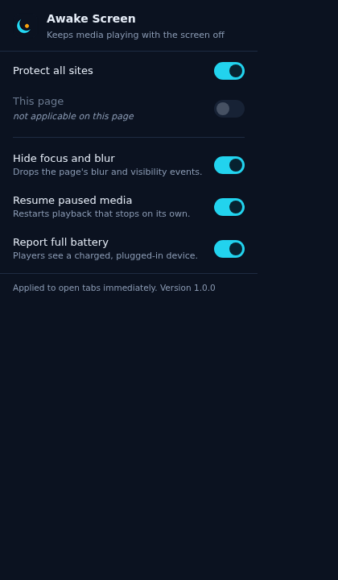

[](https://ko-fi.com/steimerbyte)
> ⭐ If you find this useful, consider [supporting me on Ko-fi](https://ko-fi.com/steimerbyte)!


# Awake Screen

<p align="center">
  <a href="https://github.com/steimerbyte/awake-screen/releases/latest"></a>
  <a href="https://github.com/steimerbyte/awake-screen/blob/main/LICENSE"></a>
</p>

A Manifest V3 extension for Chromium browsers that hides page-visibility and focus state from websites, so video and audio keep playing while the tab is in the background or the screen is off. It is built for streaming sites that stop playback the moment `document.hidden` flips to `true`. It is not an ad blocker, not a downloader, and it does not keep your display awake — it only denies the page the state it reacts to.

---

## Installation

### From a release

```bash
# pick the latest release, then:
unzip awake-screen-*.zip -d awake-screen
```

1. Open `chrome://extensions` and enable **Developer mode**.
2. **Load unpacked** → select the extracted `awake-screen` folder.
3. Reload open tabs so the content scripts run.

Download: [latest release](https://github.com/steimerbyte/awake-screen/releases/latest).

The `.crx` asset in the same release is signed with the key that pins the extension ID (`mgjpkcpohocclkjkggoaphjdodgmhaja`). Desktop Chrome no longer installs off-store CRX files interactively, so use the zip on desktop and the crx only in Chromium builds that still accept local CRX files.

### From source

```bash
git clone https://github.com/steimerbyte/awake-screen.git
cd awake-screen
```

Then load the folder unpacked as above, or start a browser against it directly:

```bash
chromium --load-extension="$PWD" --disable-extensions-except="$PWD"
```

Requires Chrome/Chromium 111 or newer — the manifest declares a MAIN-world content script, which older versions cannot load.

## Demo

<p align="center">
  
</p>

## Features

| Guard | What it does | Scope |
|---|---|---|
| Visibility spoof | `document.hidden` → `false`, `visibilityState` → `"visible"`, including the `webkit` accessors; `hasFocus()` → `true`, `wasDiscarded` → `false` | `enabled` |
| Event suppression | Stops `visibilitychange`, `webkit`/`moz`/`ms` variants, `pagehide` and `freeze` in the capture phase before any page listener runs. `blur`/`focusout` are stopped only when the target is `window` or `document`, never for elements | `strictFocus` |
| Media resume | Re-plays an element that was paused while the document is really hidden — including the pause Chrome itself fires when it suspends background media | `resumeGuard` |
| Media Session respect | A `pause`/`stop` from the lock screen or a headset button is honoured and never resurrected | `resumeGuard` |
| Battery spoof | `navigator.getBattery()` resolves `charging: true`, `level: 1`, `chargingTime: 0`, `dischargingTime: Infinity`, since some players throttle on low battery | `batterySpoof` |

Every guard reads a live state object, so switching one off in the popup applies to already-open tabs without a reload. The native accessors are captured before patching and returned unchanged while protection is off for a site.

## How it works

Two content scripts run at `document_start` in every frame:

- `src/bridge.js` — ISOLATED world. Reads `chrome.storage.sync`, computes the effective config for `location.hostname` and publishes it on `document.documentElement.dataset.awakeCfg` plus a plain `awake:cfg` event. Strings cross the isolated/main world boundary reliably; objects do not. It re-publishes on `chrome.storage.onChanged`, `pageshow` (bfcache) and `DOMContentLoaded`, and waits for `<html>` with a `MutationObserver` when `document_start` beats the parser.
- `src/main-world.js` — MAIN world, so it patches the prototypes page scripts actually use. It installs with defaults immediately and never throws: a hostile page must not be able to observe it failing.

Why the resume guard exists at all: an API-level spoof alone is not enough. Chrome suspends background media itself and fires `pause` on the element without dispatching any event the page could see — measured in this repo's harness as `play@9 … playing@17 pause@2123`, with the page's own visibility counters still at zero. The guard therefore tracks real play state instead of timing, and a download that only spoofed `document.hidden` would still stop after roughly two seconds.

## Configuration

All keys live in `chrome.storage.sync`, are optional, and default to on. The popup writes them; nothing else needs to.

| Key | Default | Description |
|---|---|---|
| `enabled` | `true` | Master switch. Off restores the real visibility state everywhere |
| `strictFocus` | `true` | Suppress the visibility, page-hide and window-blur event pipeline |
| `resumeGuard` | `true` | Resume media paused by a hide transition or by the browser |
| `batterySpoof` | `true` | Report a charged, plugged-in device |
| `blocklist` | `[]` | Bare hostnames where protection is off. Matches a host that equals an entry or ends with `"." + entry`, so `example.com` covers `www.example.com` but not `notexample.com` |

## Troubleshooting

| Symptom | Cause |
|---|---|
| Playback still stops | The site pauses from a timer instead of a visibility event. Check the site in the popup: if the current-site row says it is off, the host is in `blocklist` |
| Nothing happens on a page | `chrome://` pages, the Web Store and `file://` URLs do not accept content scripts; enable file access per extension if you need local files |
| Extension does not load at all | Chrome/Chromium older than 111 cannot load the MAIN-world content script |
| A player refuses to start | DRM/EME streams may refuse regardless of the reported visibility state |
| The video pauses when you press pause on the lock screen | Expected: the Media Session guard deliberately lets a user pause win |

## Development

No build step, no dependencies: Chrome loads the files verbatim. The icons are generated and deterministic:

```bash
python3 tools/make-icons.py        # rewrites icons/*.png byte-identically
```

Package a signed build — one command, stages a clean copy, packs with Chrome's own
packer and verifies the result:

```bash
bash tools/package.sh          # -> dist/awake-screen-<version>.crx and .zip
```

It excludes `key.pem`, the harness, `docs/` and VCS metadata from the staging copy
before packing, then asserts magic, CRX version, embedded key, derived extension ID,
the RSA signature and that the payload is byte-identical to the staged tree
(`tools/verify-crx.py`). `key.pem` is not in the repository. Generate your own with `openssl genrsa -out key.pem 2048` and put its public key in `manifest.json` under `key` if you want a stable extension ID.

### Verification

```bash
bun test/verify.mjs                      # 44 checks against the working tree
EXT_DIR=/path/to/unpacked bun test/verify.mjs   # same checks against a packaged build
```

The harness launches real Chromium from the Playwright cache with `--load-extension`, serves `test/page.html` under two hostnames of one server (one blocklisted) and backgrounds both tabs through raw CDP. Only one tab per window is genuinely visible, so the blocklisted tab reporting `hidden` and zero delivered events is what proves the protected tab's `visible` is the extension's doing. No mocks and no fakes. It also writes `docs/screenshots/01-popup.png`.

## Hinweis zur KI-Unterstützung

Bei der Entwicklung dieses Projekts wurden teilweise oder vollständig KI-gestützte Tools und Technologien eingesetzt.

Konkret: Die Implementierung, die Verifikations-Harness und diese README wurden mit einem KI-Agenten erstellt. Jede Behauptung in diesem Dokument stammt aus einem Lauf des Harness gegen echtes Chromium; die Messwerte (44 Prüfungen, `pause@2123`) sind Ausgaben dieses Laufs, keine Schätzungen.

## License

MIT — see [LICENSE](./LICENSE). Do what you want with it, keep the copyright notice.
